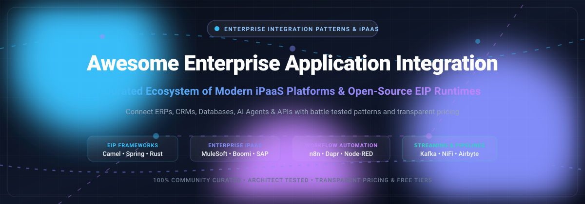

# ⚡ Awesome Enterprise Application Integration Framework

**Curated Ecosystem of Modern iPaaS Platforms & Open-Source EIP Runtimes**  
*Focused on Enterprise Integration Patterns (EIP), Cloud iPaaS, Event-Driven Architecture & Workflow Automation*  

---

## 📖 Overview

**Enterprise Application Integration (EAI)** and **Integration Platform as a Service (iPaaS)** frameworks empower modern engineering teams to seamlessly connect disparate software systems—such as ERPs, CRMs, relational/NoSQL databases, SaaS applications, and autonomous AI agents. 

Whether you need a commercial low-code iPaaS suite with managed runtime hosting or an open-source framework implementing **Enterprise Integration Patterns (EIP)** in code, this community-driven directory curates the most impactful tools, detailed starting prices, free tier quotas, and GitHub star trajectories.

---

## 📑 Table of Contents
- [📊 Sector Overview & Market Dynamics](#-sector-overview--market-dynamics)
- [☁️ SaaS / Hosted iPaaS Platforms](#️-saas--hosted-ipaas-platforms)
- [🔓 Open-Source GitHub Projects](#-open-source-github-projects)
- [💡 Architectural Guidance & Decision Framework](#-architectural-guidance--decision-framework)
- [📈 Star History](#-star-history)
- [🤝 How to Contribute](#-how-to-contribute)
- [💖 Support](#-support)
- [⚖️ Disclaimer](#️-disclaimer)

---

## 📊 Sector Overview & Market Dynamics

The global **Enterprise Application Integration (EAI)** and **Integration Platform as a Service (iPaaS)** market is currently valued between **$14.5B and $23B+** (with cloud-native iPaaS representing ~$8.5B–$10B of that total) and is on pace to exceed **$33B to $55B+ by 2030** with an estimated CAGR between 11% and 20%. 

The industry demonstrates a barbell market structure:
- **Consolidated Enterprise Top Tier**: Mega-cap software suites and established market leaders (Oracle, SAP, Salesforce/MuleSoft, IBM, and Informatica) dominate multi-million-dollar Global 2000 contracts through bundled ERP/CRM ecosystems and strict enterprise SLAs.
- **Dynamic Fragmented Long-Tail**: Driven by SaaS proliferation and microservices adoption, hundreds of agile iPaaS vendors and open-source runtimes thrive by catering to mid-market teams, specialized API transformation, asynchronous event-driven pipelines, and developer-first workflows.

---

## ☁️ SaaS / Hosted iPaaS Platforms

The following commercial and hybrid platforms offer hosted execution engines, enterprise-grade governance, and visual drag-and-drop workflow builders. The table below details entry pricing and transparent free tier limits, sorted in descending order by **Company Scale (Revenue / Valuation)**:

| 🚀 Product | 🏢 Company Scale (Revenue / Valuation) | 📝 Description | 💳 Pricing (Starting) | 🎁 Free Tier / Trial Limits |
|:---|:---|:---|:---|:---|
| **[Oracle Integration Cloud](https://www.oracle.com/)** | **~$67B+ Revenue** / **~$385B Market Cap** (Oracle) | Enterprise iPaaS with prebuilt adapters for Oracle and third-party applications. Process automation and API management included. | Standard Edition starts at **$0.6452/hour** per message pack (~**$480/month** PAYG; ~**$240/month** BYOL) | **30-day free trial** with **$300 cloud credits** via Oracle Cloud Free Tier |
| **[SAP Integration Suite](https://www.sap.com/)** | **~$45B+ Revenue** / **~$260B Market Cap** (SAP) | Enterprise integration within the SAP ecosystem. Covers process integration, API management, and event mesh for SAP and non-SAP systems. | Basic Edition starts at **£680/month** (~**$860/month** per tenant); Standard Edition from **£3,650/month** (~**$4,600/month**) | **Free Tier**: BTP Free Tier plan with monthly quotas (no expiration, production-upgradeable); **30-day trial** on shared test tenant |
| **[MuleSoft Anypoint](https://www.mulesoft.com/)** | **~$41B+ Revenue** / **~$190B Market Cap** (Salesforce parent; acquired for **$6.5B**) | Enterprise integration and API platform (Salesforce). Bundles runtime, designer (Anypoint Studio), DataWeave transformation, and API management. | MuleSoft Starter packages start at **$2,000/month** (billed annually at **$24,000/year**) | **30-day free trial** of Anypoint Platform (full API designer, runtime manager, and exchange access) |
| **[Software AG webMethods](https://www.softwareag.com/)** | **~$1B Revenue** / **~$2.4B Valuation** (Acquired by Silver Lake; IBM integration) | Hybrid integration and API management platform (IBM). Designed for enterprise B2B/EDI, MFT, and hybrid cloud orchestration. | Standard cloud edition starts at **$2,500/month** (via IBM SaaS / webMethods.io) | **30-day free trial** of webMethods.io integration & API platform |
| **[Informatica Cloud Integration](https://www.informatica.com/)** | **~$1.6B Revenue** / **~$8B Enterprise Valuation** | Enterprise iPaaS and data management (IDMC). Consumption-based pricing metered via Informatica Processing Units (IPUs). | IDMC baseline begins at **120 IPUs/month** starting at **$10,980/month** (or ~$91.50/IPU; cloud marketplace base ~$131,760/year) | **Free Data Loader** (permanent free tier for lightweight ingestion); **30-day free trial** for Cloud Data Integration |
| **[Workato](https://www.workato.com/)** | **~$150M+ ARR** / **$5.7B Valuation** (Private) | Enterprise automation platform with recipe-based workflows and a Connector SDK. Positioned for large-scale enterprise automation with AI capabilities. | Free: **$0**; Pro starting tier: **$75/month** (2,500 credits/month) or **$10,000/year** base workspace | **Free plan**: 50,000 one-time recipe credits (no expiration); **30-day free trial** for enterprise workspaces |
| **[Boomi](https://www.boomi.com/)** | **~$350M–$400M Revenue** / **$4B Valuation** (TPG / Francisco Partners) | Cloud-native iPaaS with Atom-based architecture. API Control Plane manages gateways from multiple vendors. | Pay-As-You-Go starts at **$99/month** (~$0.05/message); Standard annual contracts start at **$2,000/month** (~$24,000/year) | **30-day free trial** with full platform access (standard Atom runtime & connector testing) |
| **[Celigo](https://www.celigo.com/)** | **~$100M+ Revenue** / **~$500M+ Valuation** (Private / Insight Partners) | iPaaS with strong NetSuite and ERP focus. Starter integrations priced on active flows and endpoints. | Starter tier starts at **$500/month** (billed annually, ~$6,000/year; median contracts ~$14,787/year) | **Free plan**: 1 active flow between 2 endpoints (no expiration, no SSO); **30-day free trial** with unlimited flows |
| **[Jitterbit](https://www.jitterbit.com/)** | **~$80M–$100M Revenue** / **~$300M+ Valuation** (Private / Partners Group) | Enterprise iPaaS with Harmony low-code integration, API manager, and pre-built workflow templates. | Standard Tier annual contract starts at **$1,250/month** (billed annually at **$15,000/year**) | **30-day free trial** of Jitterbit Harmony upon registration/request approval |

---

## 🔓 Open-Source GitHub Projects

Open-source frameworks allow engineering teams to avoid steep per-core or per-flow software licensing while gaining full control over their deployment topology, compliance boundaries, and data paths. 

All repositories below include a live stargazers social badge and are **sorted in descending order by GitHub star count**:

| 📦 Repository | ⭐ Star Badge | 📝 Description & Architectural Fit |
|:---|:---|:---|
| **[n8n](https://github.com/n8n-io/n8n)** |  | **Fair-code workflow automation platform with visual node-based execution.** Built with TypeScript/Node.js. Supports 400+ native connectors, webhook handling, custom JavaScript/Python execution, and deep AI Agent / LangChain integrations. Ideal for self-hosted enterprise orchestration. |
| **[Apache Kafka](https://github.com/apache/kafka)** |  | **Distributed event streaming platform & Kafka Connect framework.** The backbone of real-time enterprise architectures. Connect framework standardizes fault-tolerant data ingestion between Kafka clusters, legacy databases (via Debezium CDC), and SaaS APIs. |
| **[Kestra](https://github.com/kestra-io/kestra)** |  | **Declarative, event-driven orchestrator and integration engine.** Apache-2.0. Enables teams to define microservices pipelines, API flows, and data transformations via clean YAML. Features real-time UI execution tracing, embedded secret management, and distributed worker architecture. |
| **[Dapr](https://github.com/dapr/dapr)** |  | **Distributed Application Runtime (Cloud Native Computing Foundation).** Provides event-driven, polyglot sidecar building blocks for microservice integration—including standardized Pub/Sub, state stores, service-to-service invocation with mTLS, bindings, and actors. |
| **[Activepieces](https://github.com/activepieces/activepieces)** |  | **Open-source no-code business automation and iPaaS alternative.** MIT licensed, TypeScript/Node.js. Offers a modern visual builder, enterprise SSO, fine-grained access control, and an open piece/connector ecosystem for internal tooling and SaaS integration. |
| **[Temporal](https://github.com/temporalio/temporal)** |  | **Durable execution platform for mission-critical enterprise workflows.** Mitigates failure scenarios in complex multi-step distributed integrations through code-based state preservation, automatic retries, saga rollbacks, and distributed timers in Go, Java, TypeScript, and Python. |
| **[Node-RED](https://github.com/node-red/node-red)** |  | **Low-code event-driven programming for wiring together hardware, APIs, and online services.** OpenJS Foundation. Widely adopted across IoT edge gateways, industrial SCADA systems, and rapid API prototyping with a lightweight browser-based flow editor. |
| **[Airbyte](https://github.com/airbytehq/airbyte)** |  | **Leading open-source ELT data integration engine.** Unifies 300+ pre-built connectors for moving structured data from SaaS applications, files, and transaction databases into cloud data warehouses, vector stores, and enterprise storage targets. |
| **[Apache Camel](https://github.com/apache/camel)** |  | **The definitive open-source reference implementation of Enterprise Integration Patterns (EIP).** Apache-2.0, Java/JVM. Boasts **~300 components** covering messaging (Kafka, JMS, AMQP), enterprise databases, cloud providers, and SaaS apps. Routes in Java, YAML, or XML DSL; visual editor via Kaoto. Runs standalone, on Quarkus/Spring Boot, or as native GraalVM images. |
| **[Apache NiFi](https://github.com/apache/nifi)** |  | **Visual dataflow automation and real-time streaming ETL.** Apache-2.0, Java. Processor-based web interface for routing, converting, enriching, and mediating enterprise data across disparate networks. Best-in-class data provenance and end-to-end audit lineage tracking. |
| **[Ballerina](https://github.com/ballerina-platform/ballerina-lang)** |  | **Cloud-native programming language designed specifically for integration.** Apache-2.0. Treats network endpoints, JSON/XML schemas, and concurrency as first-class language constructs. Features bidirectional graphical sequence diagrams alongside clean source code. |
| **[Spring Integration](https://github.com/spring-projects/spring-integration)** |  | **Enterprise Integration Patterns natively embedded in the Spring Framework.** Apache-2.0, Java. Lightweight messaging framework extending Spring with EIP constructs—message channels, content-based routers, splitters, aggregators, and adapters. The top choice for Spring Boot microservice architectures. |
| **[Frank!Framework](https://github.com/frankframework/frankframework)** |  | **Stateless Java integration framework for enterprise transactional exchange.** Apache-2.0. Offers a declarative XML/Java approach to bridge banking, government, and enterprise legacy systems with built-in Ladybug test/trace instrumentation. |
| **[Kaoto](https://github.com/KaotoIO/kaoto)** |  | **Visual low-code canvas editor for Apache Camel integration routes.** Apache-2.0. Visualizes and modifies Camel YAML DSL definitions in real time inside VS Code and web environments, uniting code-first developers and low-code architects. |
| **[WSO2 Micro Integrator](https://github.com/wso2/micro-integrator)** |  | **Lightweight, container-native integration runtime built for cloud & Kubernetes.** Apache-2.0. Optimized Synapse-based engine for high-throughput enterprise service bus (ESB) mediation, protocol transformations (HTTP/JMS/FTP/Kafka), and graphical VS Code tooling. |
| **[Cameleer](https://github.com/pmsudhi/cameleer)** |  | **Ultra-lightweight native Rust runtime for Apache Camel routes.** Apache-2.0. Executes Camel YAML/XML DSLs with **2.5 ms startup and ~7 MB peak memory**. Includes a native Model Context Protocol (MCP) server for safe, audit-logged AI agent tool execution. |

---

## 💡 Architectural Guidance & Decision Framework

Selecting the right integration architecture depends on throughput, latency, governance, and organizational skills:

- **Enterprise-Wide Standard (Java / Polyglot)**: Deploy **[Apache Camel](https://github.com/apache/camel)** or **[Spring Integration](https://github.com/spring-projects/spring-integration)** for maximum flexibility, deep EIP compliance, and no runtime license fees.
- **Microservices & Cloud-Native Sidecars**: Leverage **[Dapr](https://github.com/dapr/dapr)** for standardized pub/sub and state handling across languages, or **[Temporal](https://github.com/temporalio/temporal)** for distributed sagas and stateful business processes.
- **Event Streaming & CDC**: Build around **[Apache Kafka](https://github.com/apache/kafka)** with Kafka Connect for petabyte-scale messaging and transactional change data capture.
- **Low-Code & Business Automation**: Choose **[n8n](https://github.com/n8n-io/n8n)** or **[Activepieces](https://github.com/activepieces/activepieces)** for rapid, visually designed workflow automation across hundreds of SaaS endpoints.
- **Edge, Serverless & AI Agents**: Utilize **[Cameleer](https://github.com/pmsudhi/cameleer)** for sub-millisecond cold starts, low resource footprints, and native AI tool protocol integration.

---

## 📈 Star History

---

## 🤝 How to Contribute

We welcome community contributions! To suggest a new open-source runtime, iPaaS vendor, or architectural pattern:

1. 🍴 **Fork** the repository.
2. 🌿 Create a new branch: `git checkout -b feature/add-new-framework`.
3. 📝 Add your entry into `README.md` maintaining proper table formatting, pricing transparency, and stargazers badge links.
4. 🚀 Submit a **Pull Request** with a concise description of why the tool benefits the enterprise integration ecosystem.

---

## 💖 Support

If you found this curated enterprise integration catalog helpful, please consider supporting the project:

- ⭐ **Star this repository** to improve visibility across the GitHub developer community!
- 🍴 **Fork and share** with fellow software architects and integration engineers.
- ☕ **Buy a coffee & sponsor** future open-source curation on the [GitHub Sponsor Dashboard](https://github.com/sponsors/ishandutta2007).

---

## ⚖️ Disclaimer

- This repository is a community-curated educational index—not an endorsement of any commercial platform or open-source software project.
- Always apply enterprise security best practices: configure least-privilege credentials, rotate API keys, encrypt data in transit and at rest, and maintain thorough audit trails across all production integration routes.
- Pricing metrics, quotas, and licensing tiers reflect current publicly available data and are subject to change by respective vendors.

---

**Built with ❤️ for platform architects, integration specialists, and backend engineers.**

